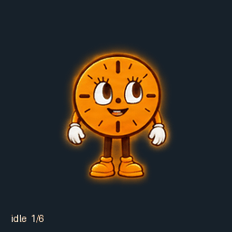
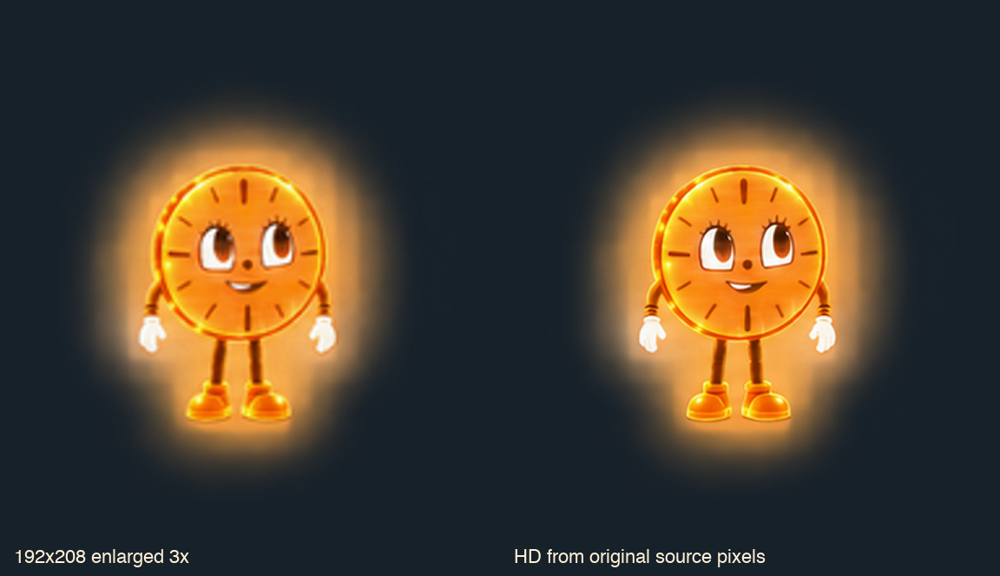

# Miss Minutes

Пиксельная Miss Minutes из «Локи»: тёплый янтарный циферблат, свечение по контуру тела, **прозрачность 60% — видимость 40%**. Бег влево и вправо совпадает по размеру и оттенку: кадры зеркальны без изменения порядка.

## Файлы

- [Готовый спрайт PNG](assets/miss-minutes.png) — RGBA, 1536 × 2288, v2, максимальная альфа 102/255.
- [Видео MP4](previews/all-states.mp4) · [GIF всех анимаций](previews/all-states.gif).
- [16 направлений взгляда](previews/look-loop.gif) · [таблица направлений](previews/directions.png).
- [Все кадры](previews/contact-sheet.png) · [прыжок](previews/idle-jump-idle.gif).
- [Светлый и тёмный фон](previews/native-dark-light.png) · [локальный проигрыватель](preview.html).
- [Исходники поз и непрозрачный мастер](source/) · [параметры](pet.json).
- [Визуальный бриф](prompts/style-brief.md) · [проверки](validation/summary.json).

73 кадра: 9 анимаций и 16 направлений взгляда. Сетка 8 × 11, ячейка 192 × 208. Пиксельный рисунок использует логическую сетку 96 × 104 с увеличением ×2. Неиспользуемые ячейки полностью прозрачны.

## Анимации

| Строка | Состояние | Кадров |
|---|---|---:|
| 0 | Покой и моргание | 6 |
| 1 | Бег вправо | 8 |
| 2 | Бег влево | 8 |
| 3 | Приветствие | 4 |
| 4 | Прыжок | 5 |
| 5 | Неудача | 8 |
| 6 | Ожидание ответа | 6 |
| 7 | Сосредоточенная работа | 6 |
| 8 | Проверка результата | 6 |
| 9 | Взгляд: 000° → 157.5° | 8 |
| 10 | Взгляд: 180° → 337.5° | 8 |

Направления идут по часовой стрелке: 000° — вверх, 090° — вправо, 180° — вниз, 270° — влево.

## Проверка

Финальный PNG прошёл геометрическую проверку, проверку качества и preflight pet-сервиса. Скачанный после установки спрайт совпадает с ним по всем RGBA-пикселям. Проверены точная формула `round(source_alpha * 0.4)`, максимум альфы 102/255 и одинаковые блоки 2 × 2. [Отчёт](validation/stored-verification.json).

Четыре кардинальных взгляда проходят независимое слепое ревью. У четырёх промежуточных направлений около горизонтальной оси вертикальная составляющая тонкая; замечания сохранены. У прыжка подъём 24 пикселя и точный возврат на исходную линию ног. [Качество](validation/pet-quality.json) · [бег](validation/run-equality.json) · [прозрачность](validation/opacity.json).

Браузерное воспроизведение этой версии заблокировано политикой доступа; нативное окно pet отдельно не проверено. GIF и MP4 собраны из точного итогового PNG и показаны на тёмном фоне, поскольку GIF не поддерживает частичную альфу. Снимки с префиксом `previous-contour-` относятся к прежней версии.

Арты созданы встроенным ImageGen по пользовательским референсам. Это неофициальный fan-art; исходные изображения-референсы не включены в репозиторий.

## Предыдущий HD-мастер ×3 и совместимость

HD ниже сохранён от предыдущей версии рисунка; текущий пиксельный вариант — в `assets/` и `previews/`.

[HD-мастер PNG](hd/miss-minutes-master-3x.png) — **4608 × 6864**, ячейка **576 × 624**, те же 73 позы. Собран заново из выбранных исходных изображений поз с сохранением регистрации и полупрозрачности. Это сохраняет исходные детали, потерянные при уменьшении runtime-спрайта; новые позы и детали не дорисовывались.

[HD-видео](hd/all-states-hd.mp4) · [HD GIF](hd/all-states-hd.gif) · [один кадр PNG](hd/miss-minutes-character-3x.png) · [интерактивное сравнение](hd/preview.html).

Проверено в установленной версии приложения **26.1007.71326, build 20398, prod**. Проверка обновлений вернула `up_to_date`. Эта версия и pet-сервис принимают только 1536 × 2288 для v2; загрузка HD ×3 отклоняется с `invalid_dimensions`. Поэтому файл в `assets/miss-minutes.png` остаётся версией для установки, а HD-мастер предназначен для отдельного просмотра и дальнейшей обработки.

Для предыдущего HD-исследования скачанный установленный спрайт совпал по RGBA-пикселям с одобренным. Он прошёл текущий preflight. Браузерный тест локальной страницы прочитал и воспроизвёл все 73 кадра обоих PNG. Нативное окно Mini отдельно не проверено: управление нативным приложением в сессии недоступно. См. [отчёт совместимости](hd/compatibility.json) и [снимок браузерной проверки](hd/browser-playback.png).

Для интерактивного сравнения запустите HTTP-сервер из корня репозитория, например `python3 -m http.server 8000`, затем откройте `http://localhost:8000/hd/preview.html`.
